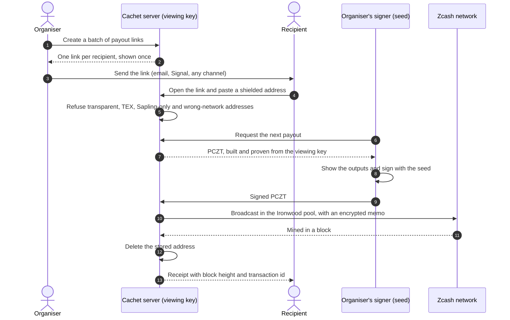
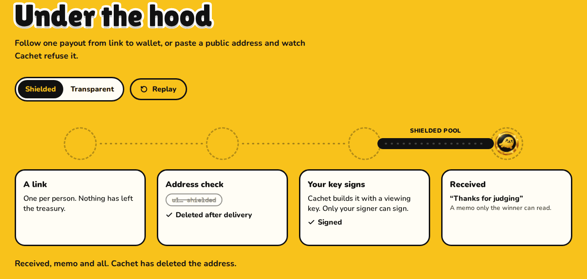

# Cachet

**Private payouts on Zcash.** Pay anyone with a link: the ZEC stays in your treasury until the recipient claims it and your key signs, then it arrives shielded.

[Live demo](https://cachet.timidan.xyz) · [Demo video](https://youtu.be/n9GtFowPyhY) · [How it works](#how-it-works) · [Privacy model](#privacy-model) · [Evidence](#evidence)


Hackathons, bounty programs and grant rounds pay people they barely know, and today that starts with collecting names and addresses in a form or a chat. That list outlives the payment. Cachet removes it. The organiser sends each recipient a link; the recipient claims it with a shielded address; the payment arrives in Zcash's Ironwood pool with the organiser's message as an encrypted memo. The server never holds the spending key, and once a payout confirms, nothing on Cachet's side can read who received it.

Built for [Zecathon 2026](https://thezecathon.com), Shielded Payments track.

## Features

- **Payout links.** One link per recipient, with an amount, a message and an expiry. Links are stored only as SHA-256 fingerprints and are shown once.
- **Shielded only.** Transparent, TEX, Sapling-only and wrong-network addresses are refused before any transaction is built.
- **Organiser-signed payouts.** Cachet runs on the treasury's full viewing key and builds each payout as a PCZT (partially created Zcash transaction). The organiser's signer checks it and signs it where the seed is kept.
- **Built to forget.** Payouts carry no outgoing viewing key and are not stored in the treasury's wallet. Cachet deletes the claimed address when the payout confirms.
- **Audit key.** The treasury's viewing key shows an accountant every amount paid out, not who received it, and cannot spend.
- **Nothing stranded.** Unclaimed links expire, and their ZEC never leaves the treasury.

## How it works



1. **Create links.** In the dashboard, the organiser sets an amount, a message and an expiry and receives one link per recipient. Nothing moves on-chain.
2. **Distribute.** The organiser sends the links over any channel. Cachet keeps only a fingerprint of each link and cannot show it again.
3. **Claim.** The recipient opens the link and pastes a unified address. Cachet checks it with `zcash-devtool inspect` and refuses any address that would make the payment public.
4. **Approve.** Cachet builds the payout from the treasury's viewing key as a PCZT and proves it. The signer, running wherever the seed is kept, prints the PCZT's outputs, signs it and returns it; Cachet broadcasts it.
5. **Confirm and forget.** When the block lands, the receipt shows the transaction id and Cachet deletes the address.

### Compared with wallet gift cards

Zodl and Vizor ship Zcash gift cards, and for a gift they are the right tool. Cachet is for paying many people out of a treasury.

| | Wallet gift cards | Cachet |
|---|---|---|
| The money moves | when the card is made | when the link is claimed and approved |
| If it's never claimed | the money waits in the card | it never leaves the treasury |
| Who can spend it | anyone holding the card's link | only the organiser's key, after a claim |
| How many at once | four cards per batch in Vizor | up to 200 links per batch |
| To receive | a wallet that redeems gift cards | any shielded unified address |

Sources: [Vizor release notes](https://github.com/chainapsis/vizor-wallet/releases) (v0.0.58 gift card groups, v0.0.60 four-card batch limit), [Zodl iOS changelog](https://github.com/zodl-inc/zodl-ios/blob/main/CHANGELOG.md) (gift card redemption).

## Zcash integration

| Component | Where | Purpose |
|---|---|---|
| Ironwood pool (NU6.3) | every payout | Fully shielded transfers: no transparent inputs or outputs; only the fee is public |
| Full viewing key (`wallet init-fvk`, ZIP 32) | [`deploy/watch-wallet.sh`](deploy/watch-wallet.sh) | The server runs on a watch-only copy of the treasury and never holds the seed |
| PCZT: `pczt create --discard-ovk`, `pczt prove` | [`lib/devtool.ts`](lib/devtool.ts) | Builds and proves each payout from the viewing key alone, with no outgoing viewing key |
| PCZT: `pczt sign` | [`signer.ts`](signer.ts) | Signs with the organiser's key on the organiser's machine |
| PCZT: `pczt send-without-storing` | [`lib/devtool.ts`](lib/devtool.ts) | Broadcasts without recording the recipient; the wallet later sees only its own change |
| Encrypted memos (ZIP 302) | [`server.ts`](server.ts) | Carries the organiser's message to the recipient only |
| Unified addresses (ZIP 316), TEX (ZIP 320) | [`lib/address.ts`](lib/address.ts) | Accepts only unified addresses with an Orchard receiver on the right network |
| ZIP 317 fees | [`server.ts`](server.ts) | 10,000-zatoshi fee per payout; payouts below 5,000 zatoshis are refused as uneconomic |
| Zebra 7.0.0 and lightwalletd | [`regtest/`](regtest/), [`deploy/`](deploy/) | The node and light-wallet server behind the demo |
| zcash-devtool (librustzcash), patched | [`patches/`](patches/) | Adds Ironwood spends to `pczt sign` (using librustzcash's existing signer) and `--discard-ovk` (`OvkPolicy::Discard`) to `pczt create` |

## Privacy model

- **On-chain.** A Cachet payout is an ordinary fully shielded Ironwood transaction. Amount, sender, recipient and memo are hidden; only the fee is public.
- **No roster.** No form or chat pairs names with addresses. Cachet never learns who a recipient is.
- **Server.** Cachet sees an address from the claim until the block, the treasury's balance and the amounts it paid out, and each request as any web server would. It does not log IP addresses; run it behind a proxy that doesn't either, or open links over Tor.
- **After confirmation.** The address is deleted from Cachet's database. Because the payout carries no outgoing viewing key and is not stored in the treasury's wallet, neither Cachet nor the audit key can recover the recipient or the memo. The organiser sees the address once, in the signer, when approving.
- **Keys.** The server holds only the full viewing key. Only the signer, run where the seed is kept, can authorise a payment, and it prints the outputs from the PCZT itself before signing.
- **Links.** A link works like cash: whoever holds it can claim it. Send links privately; they expire.

## Evidence

### Public testnet

Two claims through Cachet's normal flow on Zcash testnet (Oct 27). Cachet ran on the testnet treasury's viewing key, `signer.ts` approved each payout with the treasury's seed, and a testnet wallet claimed both links. Both are on a public explorer.

| Transaction | Block | What it shows |
|---|---|---|
| [`08f0115f681f51170b7df0fd156f371922894ce58c52fa81639e2765a698f722`](https://testnet.zecblock.com/tx/08f0115f681f51170b7df0fd156f371922894ce58c52fa81639e2765a698f722) | 4,548,153 | A claim built from the viewing key, signed by `signer.ts` and sent without an outgoing viewing key. The recipient's wallet decrypted the memo; the treasury's viewing key sees 0.00075 TAZ leave (amount plus fee) and its own change, but not the recipient or the memo. |
| [`ac3e6e1e5e8c9a4f2b01a07f4a7344284969b63fd179d74df1d01d9e56e73403`](https://testnet.zecblock.com/tx/ac3e6e1e5e8c9a4f2b01a07f4a7344284969b63fd179d74df1d01d9e56e73403) | 4,548,164 | The second link in the batch, paid from the first payout's change: 2 Ironwood inputs and 2 Ironwood outputs, nothing transparent. |

### Regtest

Payouts made through Cachet on regtest chains running Zebra 7.0.0 with Ironwood active. The first six were signed outside Cachet by the organiser's key.

| Transaction | Block | What it shows |
|---|---|---|
| `8b5da8d49bd4dfed088ba8a643452731fc83e0edc7863cc933c45dcd96e9c930`, `397562ebf36e9e2168b2a0e4c7b5e49a143a5dddfbef6cf4ebbf759990bcd20e` | 245, 246 | Two claims back to back, approved by `signer.ts`; the second was built once the first was mined. Both addresses were deleted, and the treasury's viewing key shows neither recipient |
| `0c22027329225f51fade66c6fd2dd49efa8757a2c905976f5df7a991c4786889` | 244 | First payout without an outgoing viewing key: the recipient's wallet decrypted the memo, while the treasury's viewing key sees only the 0.0005 ZEC that left and its own change |
| `67f28f0387664d302446c2ac0775888f954d23833a9f3687818e338685b80147` | 239 (live demo chain) | A demo claim on the live site, built from the viewing key and approved by the demo signer; delivered 53 s after the claim |
| `d65da8292b4d83552cacbb8e25d81a0d8b56aab892994fae3edd68063dcdffaa` | 241 | A claim through the API, approved by `signer.ts` after it printed the PCZT's outputs |
| `07eac1ca6e0b068c7a7191240376e9677ac3dd87e1f28b8dc7744d487447a2ab` | 240 | First PCZT payout: built by a watch-only wallet, signed by the seed wallet, no transparent parts; the recipient decrypted the memo |
| `c6fc3164c01517a10fcafb751dc35c983d32ccf07b630c015fe4787659c70b49` | 219 | First payout: 0 transparent inputs or outputs, 0 Sapling, 0 Orchard, 2 Ironwood actions; the only public number is the 0.0001 ZEC fee |
| `fa00ad39a37431136aaaaf39b4c8f61f473700c32d6d51affd4edb530778aece` | 232 | Why the address check exists: zcash-devtool pays a transparent address without complaint, and that payment's amount and address are public |

Regtest transactions are not visible on public explorers.

## Live demo

[cachet.timidan.xyz](https://cachet.timidan.xyz): press **Try a demo payout**, then **Testing? Use a demo address**, then **Claim payment**. The receipt shows the claim waiting for approval, then the block and transaction id once it lands, usually within a minute.

The demo environment differs from a production deployment in four ways:

- It runs on Cachet's own regtest chain (Zebra 7.0.0 with NU6.3 Ironwood rules, the rules mainnet runs today), so it doesn't depend on public testnet servers during judging. The same code paid two claims on public testnet; see [Evidence](#public-testnet).
- A signer process on the same server plays the organiser and approves every claim.
- The demo address belongs to a wallet Cachet runs, since visitors have no wallet on a private chain.
- Its traffic passes through Cloudflare, which terminates TLS and so can see each request, including a link's token, the visitor's IP address and the shielded address in a claim. A production deployment should terminate TLS on its own server.

## Architecture

| Component | Path | Role |
|---|---|---|
| Server | [`server.ts`](server.ts) | Bun process: JSON API, the built web app, PCZT construction and the confirmation worker |
| Signer | [`signer.ts`](signer.ts) | Runs where the seed is kept; inspects, signs and returns each payout |
| Wallet adapter | [`lib/devtool.ts`](lib/devtool.ts) | zcash-devtool calls behind a lock (the wallet is a single SQLite file) |
| Address policy | [`lib/address.ts`](lib/address.ts) | Decides which addresses can be paid |
| Web app | [`web/`](web/) | React 19, Vite and Tailwind CSS v4; fonts are bundled, so opening a link makes no third-party request |
| Deployment | [`deploy/`](deploy/) | Docker image with Zebra and lightwalletd for the hosted regtest demo |
| Regtest chain | [`regtest/`](regtest/) | Local Zebra and lightwalletd configuration and helper script |
| Demo film | [`video/`](video/) | Frame-by-frame recording of the real flow (puppeteer-capture) |



The live site's **Under the hood** section plays one payout: the coin hops from the link to the address check, gets stamped by your signer, crosses the shielded pool and lands with its memo. Switch to a transparent address to watch Cachet refuse it.

Payouts are built one at a time, and the next only once the previous one is mined: the treasury wallet does not record sent payouts, so it cannot know their notes are spent any earlier.

## API

Public endpoints:

| Method and path | Description |
|---|---|
| `GET /api/health` | Network and whether demo links are available |
| `GET /api/link/{token}` | Status of a link: amount, sender, note, expiry and, once paid, block height and transaction id |
| `POST /api/link/{token}/claim` | Body `{ "address": "u1…" }`. `200` queued for approval, `409` already claimed, `422` address refused |
| `POST /api/sample` | Regtest only: a demo link paid to the demo address |

Organiser endpoints require `Authorization: Bearer <ADMIN_TOKEN>`:

| Method and path | Description |
|---|---|
| `GET /api/admin/treasury` | Balance, funds reserved for open links, payouts awaiting approval and the audit key |
| `GET /api/admin/batches` | Batches and the status of every link |
| `POST /api/admin/batches` | Body `{ label, sender, note, zats, count, days }`. Returns the links once |
| `POST /api/admin/payouts/next` | `200 { id, pczt }` with a base64 PCZT to sign; `204` nothing to sign; `503` the previous payout is still confirming |
| `POST /api/admin/payouts/{id}` | Body `{ "pczt": "<base64>" }` with the signed PCZT. Returns `{ txid }` |

## Getting started

Requirements: [Bun](https://bun.sh) 1.1 or later, a Rust toolchain, and Go for lightwalletd.

```sh
# Build zcash-devtool with the patch, plus Zebra and lightwalletd
git clone https://github.com/zcash/zcash-devtool vendor/zcash-devtool
git -C vendor/zcash-devtool checkout 0b3436b
git -C vendor/zcash-devtool apply ../../patches/zcash-devtool-pczt.patch
cargo build --release --features regtest_support --manifest-path vendor/zcash-devtool/Cargo.toml
cargo install --locked zebrad@7.0.0 --root vendor/zebra
(cd vendor && git clone https://github.com/zcash/lightwalletd && cd lightwalletd && go build -o lightwalletd .)

# Start a regtest chain
regtest/up.sh start

# Create the treasury (seed) wallet with `zcash-devtool wallet init`, then Cachet's watch-only copy
deploy/watch-wallet.sh wallet-regtest wallet-watch

# Build the web app and run the server, then the signer where the seed is kept
bun run build
bun server.ts
SIGNER_WALLET=wallet-regtest bun signer.ts
```

The signer asks for confirmation before signing each payout; `--yes` signs without asking.

### Server configuration

Bun reads these from `.env`.

| Variable | Default | Description |
|---|---|---|
| `NETWORK` | `regtest` | `main`, `test` or `regtest` |
| `WALLET_DIR` | `wallet-watch` | The watch-only treasury wallet |
| `LWD_SERVER` | `127.0.0.1:9067` | lightwalletd server, or `zecrocks` on mainnet and testnet |
| `ADMIN_TOKEN` | none | Organiser access key; a long random string |
| `PUBLIC_URL` | `http://127.0.0.1:3000` | Base URL for generated links |
| `DATA_DIR` | `data` | SQLite database location |
| `PORT`, `HOST` | `3000`, `127.0.0.1` | Listen address |
| `REGTEST_RPC` | none | Regtest only: Zebra RPC used to mine blocks for the demo |
| `DEMO_RECIPIENT` | none | Regtest only: the address demo links pay |
| `DEVTOOL` | `vendor/zcash-devtool/target/release/zcash-devtool` | zcash-devtool binary |

### Signer configuration

| Variable | Default | Description |
|---|---|---|
| `CACHET_URL` | `http://127.0.0.1:3000` | The Cachet server to approve payouts for |
| `ADMIN_TOKEN` | none | The organiser access key |
| `SIGNER_WALLET` | `wallet-regtest` | The zcash-devtool wallet that holds the seed |
| `SIGNER_IDENTITY` | `<SIGNER_WALLET>/key.txt` | The age key that decrypts the seed |

For mainnet, set `NETWORK=main` and `LWD_SERVER=zecrocks`, fund the treasury's unified address, and keep the seed wallet off the server.

## Testing

- `bun test lib` covers the address policy: a unified address with a shielded receiver is accepted, and a transparent address is refused.
- End to end on regtest: create a batch, claim with a transparent address (refused) and a unified address, approve with the signer, and confirm that the receipt shows the transaction, the stored address is deleted, and the treasury's viewing key does not show the recipient.

## Limitations

- zcash-devtool is a developer tool, not a hardened production wallet.
- Payouts go out one per block. Building several outputs into one PCZT would raise throughput for large batches.
- The organiser's signer sees each recipient address while approving; that is inherent to approving a payment.
- Mainnet is configured but has not yet carried a live payout.

## License

[MIT](LICENSE)
