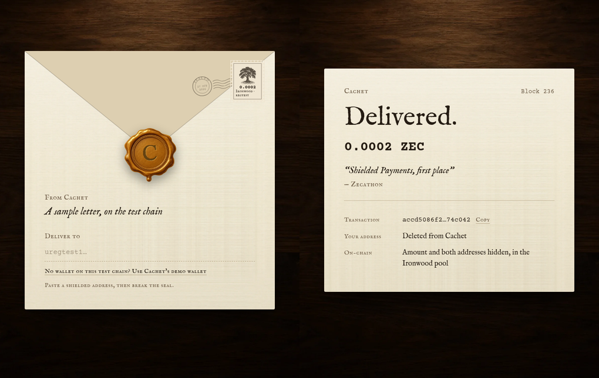
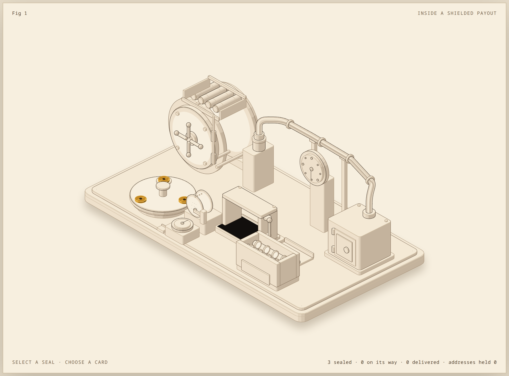

# Cachet

Pay anyone with a link: your ZEC stays in your treasury until they claim it, then arrives shielded.

[Live demo](#try-it-in-60-seconds) · [Video](#) · [Evidence](#evidence) · [How it works](#how-it-works)



Hackathons, bounty programs and grant rounds pay people they barely know. Today they collect everyone's name and address in a form or a Telegram chat first, and that list outlives the payment. Cachet skips the list: the organiser creates a link, the recipient claims it with a shielded address, and the payment arrives in Zcash's Ironwood pool with the organiser's note as an encrypted memo. Cachet deletes the address as soon as the block confirms the payment.

## How it works

1. **Create links.** In the dashboard, the organiser sets an amount, a message and an expiry, and gets one link per recipient. Nothing moves on-chain yet.
2. **Send the links** over email, Signal or any channel. Cachet keeps only a SHA-256 fingerprint of each link, so it can't show them again.
3. **Claim.** The recipient opens their link, pastes a unified address and presses Claim. Transparent and Sapling-only addresses are refused before any payment is built: a payment to them would be public.
4. **Pay shielded.** Cachet's worker pays the address from the treasury in the Ironwood pool, with the note as a memo encrypted to the recipient.
5. **Forget.** When the block lands, the receipt shows the transaction id and Cachet sets the stored address to empty. A link nobody opens expires, and its money never left the treasury.

## Why not a wallet gift card?

Zodl and Vizor already ship Zcash gift cards, and for a gift they are the right tool. Cachet is for paying many people out of a treasury.

| | Wallet gift cards | Cachet |
|---|---|---|
| The money moves | when you make the card | when they claim the link |
| If it's never claimed | the money waits in the card | it never leaves your treasury |
| How many at once | four cards per batch in Vizor | up to 200 links per batch |
| To receive | a wallet that redeems gift cards | any shielded address |

Sources: [Vizor release notes](https://github.com/chainapsis/vizor-wallet/releases) (v0.0.58 gift card groups, v0.0.60 four-card batch limit), [Zodl iOS changelog](https://github.com/zodl-inc/zodl-ios/blob/main/CHANGELOG.md) (gift card redemption).

## Zcash integration

| What Cachet uses | Where | What it does for the user |
|---|---|---|
| `zcash-devtool wallet send` (librustzcash, NU6.3 Ironwood and NU7) | [`lib/devtool.ts`](lib/devtool.ts) | Builds, proves and broadcasts each payout from the treasury's Ironwood notes |
| Encrypted memos | [`server.ts`](server.ts) `memo()` | The organiser's note travels inside the payment, readable only by the recipient |
| `zcash-devtool inspect` | [`lib/address.ts`](lib/address.ts) | Refuses transparent, Sapling-only and wrong-network addresses before anything is sent |
| `sync` + `list-tx` | [`lib/devtool.ts`](lib/devtool.ts) | Confirms delivery by block height, then the address is deleted |
| Note splitting (`shield --target-note-count 4`) | treasury setup | Lets several payouts go out back to back without waiting for change |
| Zebra 7.0.0 + lightwalletd, regtest at NU6.3 | [`regtest/`](regtest/) | The chain behind the demo, on the same rules mainnet runs today |

## Evidence

Payouts made through Cachet on its regtest chain (Zebra 7.0.0, Ironwood active):

| Transaction | Block | What it shows |
|---|---|---|
| `72e7f8083940d57014bc4e8cb14e869a9a056379d9de959a31014016b92a1ba0` | 233 | A claim through the API: 0.0002 ZEC; the recipient's wallet decrypted the memo "Thanks for judging — Zecathon" |
| `c6fc3164c01517a10fcafb751dc35c983d32ccf07b630c015fe4787659c70b49` | 219 | The first payout: 0 transparent inputs or outputs, 0 Sapling, 0 Orchard, 2 Ironwood actions; the only public number is the 0.0001 fee |
| `fa00ad39a37431136aaaaf39b4c8f61f473700c32d6d51affd4edb530778aece` | 232 | Why Cachet refuses transparent addresses: zcash-devtool paid one, and the amount and address are public |

Regtest transactions can't be looked up on a public explorer. A mainnet payout is listed here once it confirms.

Tests: `bun test lib` checks the address policy (a unified address is paid; a transparent one is refused).

## Try it in 60 seconds

On the live demo, press **Try a demo payout**, then **Testing? Use a demo address**, then **Claim payment**. The payment is a real shielded transaction on the regtest chain; the demo wallet is Cachet's own, because nobody has a wallet on a private test chain. The receipt shows the block and transaction id when it lands.

## Privacy model and limits

- **On-chain**, a Cachet payout is an ordinary shielded transaction: the amount, the treasury and the recipient are hidden. It looks the same as paying someone directly from a shielded wallet.
- **What Cachet removes** is the list: no form or chat holds names next to addresses, and the server keeps each address only between the claim and the block.
- **What Cachet's server sees**: the address while it pays it, and the request like any web server. Cachet itself doesn't log IP addresses; run it behind a proxy that doesn't either, or open links over Tor.
- **Links work like cash.** Whoever holds a link can claim it, so send them privately. They expire.
- **The treasury is a hot wallet** on the organiser's server. Keep only what you plan to pay out.
- **zcash-devtool is a developer tool**, not a hardened production wallet.
- The demo runs on **regtest** with NU6.3 (Ironwood) rules, the rules mainnet runs today. NU7 is active on public testnet but not yet on mainnet.

## Architecture



The figure above is interactive on the live site (Under the hood): pick a link, choose a shielded or a transparent address, and watch the refusal, the payment and the address deletion. It is built from 180 parts; its numbers come from the server's real behaviour.

One Bun process (`server.ts`) serves the JSON API, the built web app and an in-process payout worker. Links live in SQLite as SHA-256 hashes. The worker calls zcash-devtool for every payout, behind a lock because the wallet is one SQLite file. The web app (`web/`) is React with Vite; its fonts are bundled, so opening a link makes no third-party request.

## Run it yourself

```sh
# 1. Build the wallet (Rust) and the regtest chain
cargo build --release --features regtest_support --manifest-path vendor/zcash-devtool/Cargo.toml   # github.com/zcash/zcash-devtool
cargo install --locked zebrad@7.0.0 --root vendor/zebra
(cd vendor && git clone https://github.com/zcash/lightwalletd && cd lightwalletd && go build -o lightwalletd .)
regtest/up.sh start

# 2. Configure (.env is read by Bun)
#    NETWORK=regtest  WALLET_DIR=wallet-regtest  LWD_SERVER=127.0.0.1:9067
#    REGTEST_RPC=http://127.0.0.1:18232  ADMIN_TOKEN=<long random string>  PUBLIC_URL=http://127.0.0.1:3000

# 3. Run
(cd web && npm install && npm run build)
bun server.ts
```

For mainnet, set `NETWORK=main` and `LWD_SERVER=zecrocks`, and fund the treasury's unified address.

Built for [Zecathon 2026](https://thezecathon.com), Shielded Payments track. The research behind the positioning is in [`docs/research/`](docs/research/).
